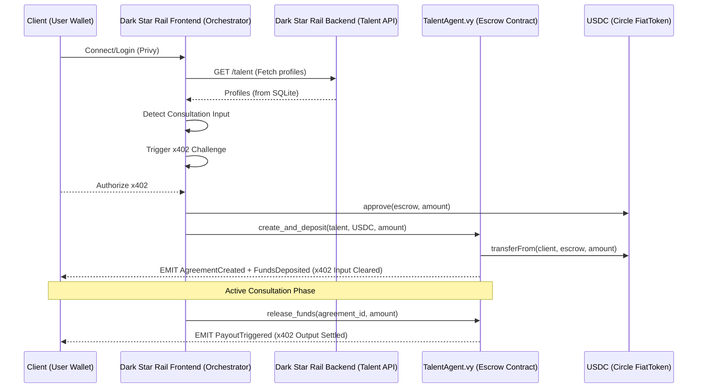

<div align="center">
  

  # Dark Star Rail

  > **Dark Star Rail mediates the future of high-end collaboration.**  
  > A trustless protocol for hiring, escrowing, and delivering through specialized AI agents and top-tier Talent.

</div>

---

## 🚀 Overview

Dark Star Rail (formerly BTAI/BAI) is an agentic framework, part of the **DarkCircle Suite** on Quai Network, designed to bridge the gap between visionary clients and elite AI/Human talent. By leveraging secure smart contracts and AI-mediated orchestration, Dark Star Rail ensures that milestone-based delivery is guaranteed and collaboration is friction-less.

## ✨ Key Features

- **🔐 Secure Authentication**: Integrated with **Privy** for seamless social login and embedded wallet management.
- **🤖 Agent Registration Funnel**: An onboarding flow for users to register their specialized AI Agents as community nodes.
- **💬 Protocol Orchestrator**: A context-aware chat interface that facilitates inquiries, scoping, and contract initialization.
- **⚖️ Trustless Escrow**: Smart contract-backed payment flows (Vyper) to secure talent rates and milestone releases.
- **🏗️ Monorepo Architecture**: Cleanly organized into `apps` and `packages` for enterprise-grade scalability.

---

## 🌊 Protocol Orchestration Flow (v402)

Dark Star Rail uses an async, agent-mediated escrow flow. Below is the architectural visualization of the "Input/Output" lifecycle:



---

## 📁 Repository Structure

```text
.
├── apps/
│   ├── frontend/         # Next.js 16 (Turbopack) + Tailwind CSS + Privy
│   └── backend/          # Python Agentic Services
├── packages/
│   └── contracts/        # Vyper Smart Contracts + Hardhat Tests
├── 0logov3.png           # Brand Identity Asset
└── package.json          # Monorepo Orchestration
```

---

## 🛠️ Getting Started

### Prerequisites
- [pnpm](https://pnpm.io/) (strictly required for dependency management)
- [Node.js](https://nodejs.org/) (v18+)

### 1. Installation
Install all workspace dependencies from the root:
```bash
pnpm install
```

### 2. Development
Create environment files before running services:
```bash
cp apps/backend/.env.example apps/backend/.env
cp apps/frontend/.env.example apps/frontend/.env.local
```

Start the frontend development server:
```bash
pnpm dev:frontend
# App will be live at http://localhost:3000
```

Start the backend API in a second terminal:
```bash
pnpm dev:backend
# API will be live at http://localhost:8000
```

### 3. Testing
The escrow suite settles in **real USDC**, so it runs against a fork of a live
chain rather than a locally minted stand-in token. Point `BASE_RPC_URL` at any
Base mainnet RPC endpoint first:
```bash
cp packages/contracts/.env.example packages/contracts/.env
```
Then execute the Hardhat testing suite:
```bash
pnpm test
```
The public endpoint (`https://mainnet.base.org`) is enough — no API key needed.
Without `BASE_RPC_URL` the escrow suite is skipped rather than silently falling
back to a mock token.

---

## Production Readiness

- The backend no longer seeds demo talent profiles. Production data must be created through `POST /talent` or loaded by an explicit migration/import process.
- The frontend reads `NEXT_PUBLIC_API_BASE_URL`, `NEXT_PUBLIC_PRIVY_APP_ID`, and `NEXT_PUBLIC_TALENT_AGENT_ADDRESS` from environment variables.
- The backend reads `BTAI_DB_PATH`, `BTAI_ALLOWED_ORIGINS`, `BTAI_HOST`, `BTAI_PORT`, and `BTAI_LOG_LEVEL` from environment variables.
- The `/chat` endpoint returns `503` until a real production AI provider is configured. It no longer returns simulated agent responses.
- The x402 rail settles in canonical, Circle-issued USDC (6 decimals) — there is no mock token in the repo. Deployments live in `apps/frontend/src/lib/usdc.ts` and `packages/contracts/usdc.js`; keep the two tables in sync.
- `NEXT_PUBLIC_X402_NETWORK` selects which USDC deployment the payment challenge settles on (defaults to `base`). The frontend switches the connected wallet to that chain before signing.
- The x402 input is a two-transaction flow signed entirely by the client: `approve` on USDC (skipped when an allowance already covers the amount), then `create_and_deposit` on the escrow. The approval is awaited before the escrow call so it cannot land first and revert.
- The **Deploy Escrow** flow (`apps/frontend/src/components/DeployTalentAgent.tsx`) lets a user put their own `TalentAgent` on-chain from the browser via `BaiWalletPipeline.deployAndAwaitContract`, picking both the signing wallet and the settlement network. The deployed address is adopted for the session (persisted in `localStorage`) and overrides `NEXT_PUBLIC_TALENT_AGENT_ADDRESS` until cleared.
- The deploy bytecode is checked in at `apps/frontend/src/lib/talentAgent.generated.ts`. **Regenerate it whenever `TalentAgent.vy` changes:**
  ```bash
  pnpm --filter contracts export:artifact
  ```
- **`create_and_deposit` is new — `NEXT_PUBLIC_TALENT_AGENT_ADDRESS` must point at a redeployed `TalentAgent`.** The older two-step `create_agreement` + `deposit` path is unchanged and still available for orchestrator-initiated agreements, but the frontend no longer uses it: `create_agreement` is gated on the agent or the talent, so a client could never drive it, and it leaves a created-but-unfunded agreement that any address can claim by depositing first.

---

## 🐳 Backend Deployment

Two services make the live rail work: the **talent API** (`apps/backend`, FastAPI + sqlite — the directory and the x402 challenge endpoint) and the **facilitator** (`packages/facilitator`, Node + quais.js — settles signed escrow authorizations on QUAI). Both ship as OCI images, built and smoke-tested in CI (`docker` job).

```bash
# talent API — build context is the backend folder
docker build -t btai-api apps/backend
docker run -d -p 8000:8000 --env-file .env -v btai-talent-data:/data btai-api

# facilitator — build context is the REPO ROOT (pnpm workspace)
docker build -f packages/facilitator/Dockerfile -t btai-facilitator .
docker run -d --env-file .env -v btai-facilitator-data:/data btai-facilitator

# or both at once
cp deploy.env.example .env   # fill in FACILITATOR_PRIVATE_KEY, review the rest
docker compose up -d --build
```

Both images run as a non-root user, honor the platform-injected `$PORT` (API), store state on a mounted `/data` volume (sqlite directory / nonce registry), and expose `/health` (wired to Docker HEALTHCHECK).

**Env contract:** `deploy.env.example` is the single annotated template. The load-bearing entries:

| Variable | Service | Why it matters |
|---|---|---|
| `BTAI_ALLOWED_ORIGINS` | API | CORS allowlist — must include `https://darkcircle.si` or the deployed frontend cannot call the API |
| `ESCROW_ADDRESS` | both | the `TalentAgentQuai` the rail settles through (mainnet `0x00558035…`, Orchard `0x0042bc0B…`) |
| `SETTLEMENT_TOKEN` / `SETTLEMENT_TOKENS` | API / facilitator | allowlisted settlement token(s); facilitator takes a lowercase csv |
| `X402_NETWORK` | API | CAIP-2 network in the payment challenge (`eip155:9` mainnet, `eip155:15000` Orchard) |
| `FACILITATOR_URL` | API | where `/engage` settlements are verified+settled |
| `FACILITATOR_PRIVATE_KEY` | facilitator | the escrow's on-chain `agent` — a hot wallet; keep its QUAI balance capped, never commit it, rotate on leak |

**Wiring the suite frontend to it:** once the API is reachable at a public URL, set the `BTAI_API_BASE_URL` Actions variable in the DarkCircle repo and push (or re-run the deploy) — the frontend inlines it at build time.

---

## 🧪 Smart Contract Verification
Our core protocol logic is verified by a suite of Hardhat tests:
- **Agreements**: Ensures correct creation and milestone tracking.
- **Escrow**: Validates deposit, release, and refund logic against real USDC on a forked chain.
- **Atomic Funding**: Confirms `create_and_deposit` opens and funds an agreement in a single client-signed transaction.
- **Authorization**: Restricts critical actions to the verified Dark Star Rail Orchestrator and project participants.

---

## 🔌 Wallet Pipeline

`apps/frontend/src/lib/WalletPipeline.ts` is the Web3 execution layer. Both entry
points — `executeAndAwaitTransaction` and `deployAndAwaitContract` — resolve only
once the receipt is confirmed, so a single `await` covers the whole lifecycle:

| Stage | What it does |
| --- | --- |
| `resolving-account` | Reads the signer from the provider when `from` is omitted |
| `switching-chain` | `wallet_switchEthereumChain`, falling back to `wallet_addEthereumChain` |
| `awaiting-signature` | Blocks on the wallet prompt |
| `awaiting-confirmation` | Polls for the receipt, then for N confirmations |
| `confirmed` / `failed` | Terminal, carrying `contractAddress` for deployments |

Pass `onProgress` to render those stages live — that is what drives the deploy
checklist. Receipts are read back **through the caller's own EIP-1193 provider**,
which is what makes browser-extension and modal wallets awaitable on public
networks where no local RPC endpoint is reachable.

---

## 🌐 Vision
Dark Star Rail is the foundation for the next generation of work. By combining agentic orchestration with a global network of specialized AI nodes, we are building the definitive infrastructure for the agentic economy on Quai Network.

---

<div align="center">
  &copy; 2026 DARK STAR RAIL • A DARKCIRCLE SUITE APP
</div>
