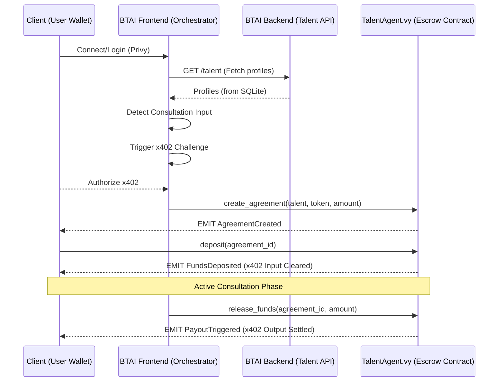

<div align="center">
  

  # BTAI Talent Protocol

  > **BTAI mediates the future of high-end collaboration.**  
  > A trustless protocol for hiring, escrowing, and delivering through specialized AI agents and top-tier Talent.

</div>

---

## 🚀 Overview

BTAI (formerly BAI) is an agentic framework designed to bridge the gap between visionary clients and elite AI/Human talent. By leveraging secure smart contracts and AI-mediated orchestration, BTAI ensures that milestone-based delivery is guaranteed and collaboration is friction-less.

## ✨ Key Features

- **🔐 Secure Authentication**: Integrated with **Privy** for seamless social login and embedded wallet management.
- **🤖 Agent Registration Funnel**: An onboarding flow for users to register their specialized AI Agents as community nodes.
- **💬 Protocol Orchestrator**: A context-aware chat interface that facilitates inquiries, scoping, and contract initialization.
- **⚖️ Trustless Escrow**: Smart contract-backed payment flows (Vyper) to secure talent rates and milestone releases.
- **🏗️ Monorepo Architecture**: Cleanly organized into `apps` and `packages` for enterprise-grade scalability.

---

## 🌊 Protocol Orchestration Flow (v402)

The BTAI Talent Protocol uses an async, agent-mediated escrow flow. Below is the architectural visualization of the "Input/Output" lifecycle:



---

## 📁 Repository Structure

```text
.
├── apps/
│   ├── frontend/         # Next.js 16 (Turbopack) + Tailwind CSS + Privy
│   └── backend/          # Python Agentic Services
├── packages/
│   └── contracts/        # Vyper Smart Contracts + Hardhat Tests
├── BOLTM.jpeg            # Brand Identity Asset
└── package.json          # Monorepo Orchestration
```

---

## 🛠️ Getting Started

### Prerequisites
- [pnpm](https://pnpm.io/) (strictly required for dependency management)
- [Node.js](https://nodejs.org/) (v18+)

### 1. Installation
Install all workspace dependencies from the root:
```bash
pnpm install
```

### 2. Development
Create environment files before running services:
```bash
cp apps/backend/.env.example apps/backend/.env
cp apps/frontend/.env.example apps/frontend/.env.local
```

Start the frontend development server:
```bash
pnpm dev:frontend
# App will be live at http://localhost:3000
```

Start the backend API in a second terminal:
```bash
pnpm dev:backend
# API will be live at http://localhost:8000
```

### 3. Testing
Execute the Hardhat testing suite for the smart contracts:
```bash
pnpm test
```

---

## Production Readiness

- The backend no longer seeds demo talent profiles. Production data must be created through `POST /talent` or loaded by an explicit migration/import process.
- The frontend reads `NEXT_PUBLIC_API_BASE_URL`, `NEXT_PUBLIC_PRIVY_APP_ID`, and `NEXT_PUBLIC_TALENT_AGENT_ADDRESS` from environment variables.
- The backend reads `BTAI_DB_PATH`, `BTAI_ALLOWED_ORIGINS`, `BTAI_HOST`, `BTAI_PORT`, and `BTAI_LOG_LEVEL` from environment variables.
- The `/chat` endpoint returns `503` until a real production AI provider is configured. It no longer returns simulated agent responses.

---

## 🧪 Smart Contract Verification
Our core protocol logic is verified by a suite of Hardhat tests:
- **Agreements**: Ensures correct creation and milestone tracking.
- **Escrow**: Validates deposit, release, and refund logic.
- **Authorization**: Restricts critical actions to the verified BTAI Orchestrator and project participants.

---

## 🌐 Vision
BTAI is the foundation for the next generation of work. By combining **BTAIZERO**'s orchestration with a global network of specialized AI nodes, we are building the definitive infrastructure for the agentic economy.

---

<div align="center">
  &copy; 2026 BTAI TALENT INTERFACE • SECURED BY V3 MILA
</div>
